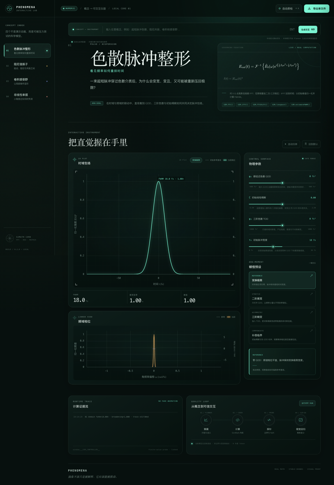

# Phenomena

把抽象概念变成**真实计算、可交互、可自动质检**的科学仪器。



## 快速开始

直接双击 `index.html` 可以离线使用四个内置模型。完整工作台（包括未知概念的动态生成）运行：

```bash
npm install
npm start
```

打开 `http://127.0.0.1:4173`。

启动后有两层能力：

- **本地数值内核**：超短脉冲色散、阻尼谐振子、卷积感受野、非线性单摆，无需 API Key。
- **动态蓝图生成**：本地路由未命中时，由 Planner 生成 JSON 蓝图，经白名单编译器校验、边界探针计算后注册为新的交互仪器。

## 内置科学模型

| 模型 | 真实计算路径 |
| --- | --- |
| 色散脉冲整形 | 高斯脉冲 FFT → 频域二阶/三阶相位 → IFFT → 强度与 FWHM |
| 阻尼谐振子 | 受迫二阶微分方程 RK4 积分 + 解析幅频响应 |
| 卷积感受野 | 合成 48×48 输入 + 高斯核二维卷积 + ReLU + 局部探针 |
| 非线性单摆 | 真实 `sin θ` 方程 RK4 积分 + 小角度解析基线 + 相空间 |

每个模型都提供固定 Ghost Baseline、语义明确的参数边界、测量指标和 Aha-Moment 预设。
滑块的上下限是计算契约的一部分，运行时还会再次钳制，避免异常输入把曲线推出有效域。

## 动态生成

默认使用 DeepSeek 的 OpenAI-compatible Chat Completions 接口：

```bash
export DEEPSEEK_API_KEY="your-key"
npm start
```

可选配置：

| 环境变量 | 默认值 | 作用 |
| --- | --- | --- |
| `DEEPSEEK_API_KEY` | 空 | 动态生成密钥 |
| `DEEPSEEK_BASE_URL` | `https://api.deepseek.com` | OpenAI-compatible API 根地址 |
| `PHENOMENA_LLM_MODEL` | `deepseek-chat` | Planner 模型名 |
| `LLM_TIMEOUT_MS` | `90000` | 请求超时 |
| `PHENOMENA_DYNAMIC` | `on` | 设为 `off` 可关闭动态生成 |

兼容入口也接受 `OPENAI_API_KEY` / `OPENAI_BASE_URL` / `LLM_API_KEY` /
`LLM_BASE_URL`。密钥只从服务端环境变量读取，不会下发到浏览器。

### 安全边界

动态生成**不是任意 JavaScript 代码生成器**。Planner 只能输出结构化 JSON，
`blueprint-compiler.js` 随后执行以下约束：

- 输出步骤仅允许 `series`、`scalar`、`indicator`；
- 表达式只允许数值、控制量、`t`、`i` 和白名单数学函数；
- 禁止任意标识符、赋值、对象、数组、字符串、网络调用和副作用；
- 最多 6 个控制量、8 个计算步骤、1200 个采样点；
- 参数、预设和运行时输入都会钳制到 `[min, max]`；
- 默认参数和全局双边界必须产生有限结果；
- 当前动态视图仅支持 `2D_Plot`、`Dual_Plot`、`Parameter_Sweep`。

无法被这套表达式图严谨表达的概念会返回 `unsupported`，不会退化成假曲线。
需要 FFT、RK4、卷积热力图或相空间的模型应继续使用内置真实内核，
或先扩展编译器和渲染原语。

## API

```text
GET  /api/status
GET  /api/examples
POST /api/generate
```

示例：

```bash
curl -s http://127.0.0.1:4173/api/status
```

```bash
curl -s http://127.0.0.1:4173/api/generate \
  -H 'Content-Type: application/json' \
  -d '{"concept":"RC 电路的时间常数与指数衰减"}'
```

未配置 Key 时，`/api/generate` 返回结构化的 `PROVIDER_NOT_CONFIGURED`，
内置四套内核不受影响。

## Golden Few-Shot

`examples/golden/` 保存四个结构样本。Planner 会按关键词选择最相近的样本，
只学习 JSON 组织方式，不把样本方程当成答案：

- `pulse.json`：双域 / 频谱相位问题
- `oscillator.json`：微分方程 / 共振问题
- `cnn.json`：网格张量与局部算子
- `pendulum.json`：刚体轨迹与非线性基线

## 自动质检

```bash
npm test
npm run export:demo
npm run test:browser
```

质量门当前覆盖：

- `58` 个数值、物理趋势、API、编译器、安装和导出测试；
- 四个内置模型的默认、全局极小、全局极大、全部预设、逐控制端点；
- 固定 fixture 的动态编译、滑块 Pixel-Diff、参数扫频副图和离线导出；
- Canvas 像素差分、计算序列 `NaN` / `Infinity` 探针；
- 浏览器 console error 与 page error；
- 桌面与移动端截图；
- 五个离线单文件 HTML 的真实浏览器交互。

动态 fixture 绕过外部模型网络，只验证“蓝图 → 编译 → 注册 → 交互 → 导出”路径。
API 测试使用本地 OpenAI-compatible mock，完整覆盖 HTTP 请求、Planner 响应、
Schema 校验、编译和边界探针。没有配置真实 API Key 时，外部 Planner 的
端到端调用不会被声称已验证。

最新证据：`artifacts/audit/report.json`  
截图：`artifacts/audit/`  
离线导出：`artifacts/exports/`

首次运行 `test:browser` 需要允许本机无头 Chromium 访问系统 IPC。默认会寻找
已缓存的 Chromium Headless Shell，也可显式指定：

```bash
PLAYWRIGHT_CHROMIUM_EXECUTABLE_PATH="/path/to/chromium" npm run test:browser
```

## 发布包

```bash
npm run package:clean
```

产物为 `artifacts/release/phenomena-release.zip`。打包脚本会排除
`node_modules`、`playwright-core`、`artifacts`、`__MACOSX`、`._*`、
`.DS_Store`，并在生成后再次检查 macOS 资源分叉文件是否混入。
`playwright-core` 仅用于开发期浏览器质检，不进入最终发布 ZIP。

## 当前限制

- 动态编译器是安全的数值表达式图，不是通用物理引擎。
- 动态页面目前以二维序列、指标和参数扫频为主，复杂三维、向量场和二维张量
  仍由内置专用渲染器负责。
- Pixel-Diff 与有限值探针已实现；VLM 只接收结构化截图证据，
  “自动把缺陷发回 Coder 自愈”仍属于后续编排能力。
- 所有可视化用于建立科学直觉，不替代专业仿真软件的收敛性与误差分析。

## 文档与目录

- [架构与故障拦截](docs/ARCHITECTURE.md)
- [Agent 系统提示词](docs/PROMPTS.md)
- `src/simmath.js`：科学计算微内核
- `src/domains.js`：四个真实物理 / 算法内核
- `src/routing.js`：本地概念语义路由
- `src/blueprint-schema.js`：Planner 提示词与 JSON 解析
- `src/blueprint-compiler.js`：白名单表达式编译与边界钳制
- `src/generation-service.js`：动态生成编排
- `src/llm-provider.js`：OpenAI-compatible 客户端
- `src/chart-renderer.js`：Canvas 绘图、网格探针与相空间原语
- `src/standalone-builder.js`：离线单文件组装
- `scripts/run-audit.mjs`：真实浏览器视觉回归
- `tests/`：数值、物理趋势、路由、API 与导出测试

## GitHub

仓库：<https://github.com/Yiding-Meng/phenomena-interactive-lab>
